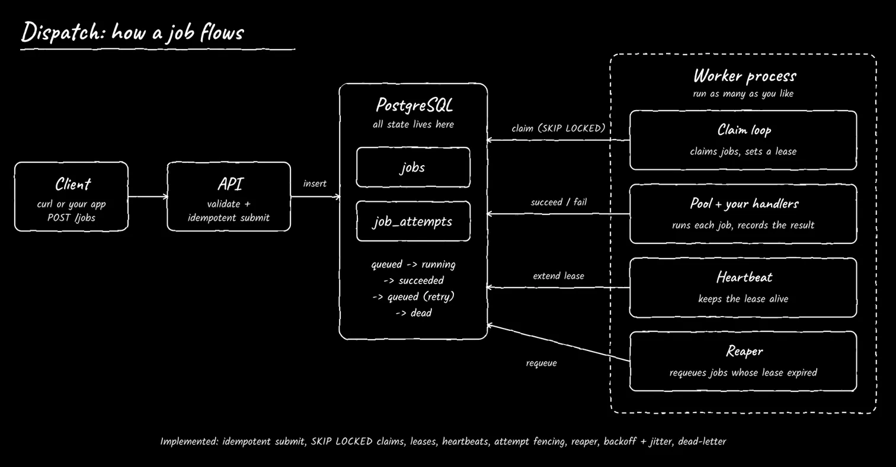

<p align="center">
  
</p>

<p align="center">
  A fault-tolerant background job queue on PostgreSQL, written in Go.
</p>

<p align="center">
  <a href="#run-it">Run it</a> ·
  <a href="#api">API</a> ·
  <a href="RESULTS.md">Results</a> ·
  <a href="BUGS.md">Bugs</a>
</p>

---

Some work shouldn't happen inside a web request: sending a webhook, building a report, calling a flaky API. You POST that work to Dispatch as a job. It is stored in Postgres, and a pool of workers runs your Go function for each one. If a worker is killed halfway through, another worker picks the job up and runs it again.

I built it to learn how queues like River and Sidekiq work, so it is small on purpose. If you need a queue in production, use River.

<p align="center">
  
</p>

All state lives in Postgres. The API and the workers keep nothing important in memory, so any of them can be killed at any time.

## Features

- Workers claim jobs with `FOR UPDATE SKIP LOCKED`, so no two workers get the same job
- A claim is a lease kept alive by heartbeats. If the worker dies, a reaper requeues the job
- Every update checks the attempt number, so a worker that lost its job can't write a result for it
- Retries with exponential backoff and jitter, then a `dead` state you can list and replay
- Idempotency key on submit, per tenant
- Per-job timeout, graceful shutdown, one row per attempt in `job_attempts`

## Run it

You need Go, Docker and [goose](https://github.com/pressly/goose).

```
docker compose up -d
make migrate
make build

./bin/api        # terminal 1
./bin/worker     # terminal 2 (start more if you like)
```

Send a job:

```
curl -s -X POST localhost:8080/jobs \
  -H "X-Tenant-ID: tenant-a" -H "Idempotency-Key: demo-1" \
  -d '{"type":"side_effect","payload":{"sleep_ms":2000}}'
```

Send the same request again and you get the same job back, not a second one. Look at it with `GET /jobs/<id>` and the same `X-Tenant-ID` header.

To see crash recovery, `kill -9` a worker while it runs a job: after the lease expires (30 s by default) another worker runs it. `make chaos` does this 20 times over 2,000 jobs.

To add your own job type, write a `func(ctx, queue.Job) error` and register it in `cmd/worker/main.go`.

## Guarantees

Dispatch is **at-least-once**. If a worker dies mid-job the job runs again, and if the first run had already done its side effect, it happens twice. Write handlers so that running twice is safe.

In 3 chaos runs (2,000 jobs, 20 `kill -9` each) no accepted job was lost and the idempotent handler never doubled its effect. See [RESULTS.md](RESULTS.md).

Limits: one Postgres is a single point of failure; workers poll, so a job can wait up to the poll interval (200 ms by default); a handler must watch its context for the timeout to work; there is no auth (the tenant comes from a header), no UI and no cron.

## Numbers

On a laptop, with Postgres on the same machine and no-op jobs:

| | |
|---|---|
| throughput | about 4,600 jobs/s with 16 workers |
| wait before start (p99, 20 ms poll) | 2 to 17 ms at 500 to 2,000 jobs/s |
| recovery after `kill -9` | about the lease length |
| `SKIP LOCKED` vs select-then-update | 15,473 vs 1,112 claims/s, no double claims |

Charts and caveats are in [RESULTS.md](RESULTS.md). Latency at 3,000 jobs/s is unstable and I don't know why yet; that and the bugs I hit while building are in [BUGS.md](BUGS.md).

## API

Every route needs `X-Tenant-ID`. `POST /jobs` also needs `Idempotency-Key`.

```
POST /jobs                submit (201 new, 200 same key and payload, 409 same key different payload)
GET  /jobs?status=&limit= list jobs (status=dead is the dead-letter list)
GET  /jobs/:id            one job
POST /jobs/:id/cancel     cancel a job that hasn't started
POST /jobs/:id/replay     put a dead job back, 5 more attempts
GET  /stats               counts by status
```

## Config

Environment variables. Worker: `DATABASE_URL`, `WORKER_CONCURRENCY` (4), `WORKER_LEASE` (30s), `REAPER_INTERVAL` (5s), `WORKER_POLL_INTERVAL` (200ms), `DB_MAX_CONNS` (20). API: `ADDR` (`:8080`).

## Layout

```
cmd/               api, worker, chaos (the kill -9 test), bench
internal/queue     the SQL: claim, succeed, fail, reap, replay
internal/worker    claim loop, goroutine pool, heartbeat, shutdown
internal/reaper    requeues expired leases
internal/retry     backoff and jitter
internal/api       routes, idempotent submit
migrations/        schema
results/           raw benchmark and chaos output
```

## Tests

`make test` runs `go test -race ./...`. Each test starts its own Postgres with testcontainers, so Docker must be running. It takes a few minutes.

## Not done

Per-tenant limits, metrics, `LISTEN/NOTIFY`, cancelling running jobs, and stopping the handler of a job that lost its lease.

## License

MIT