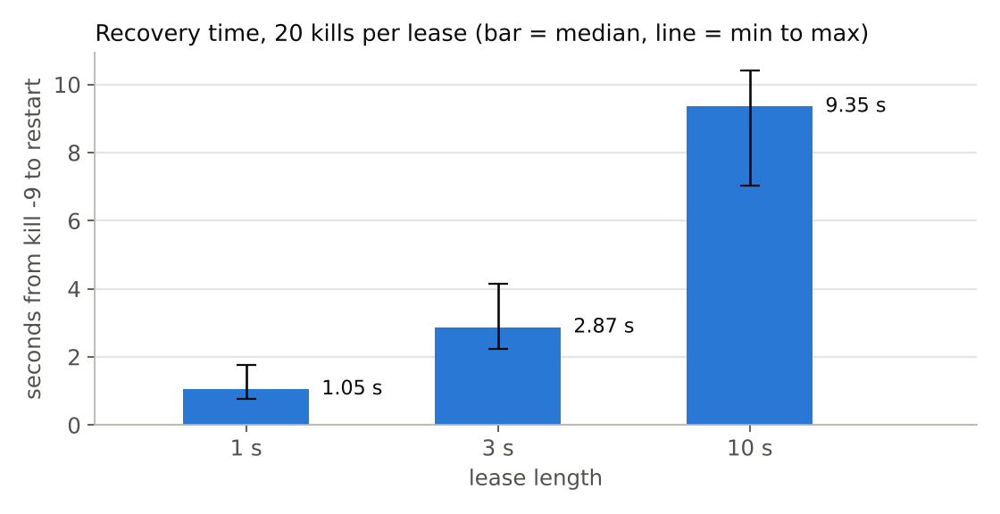
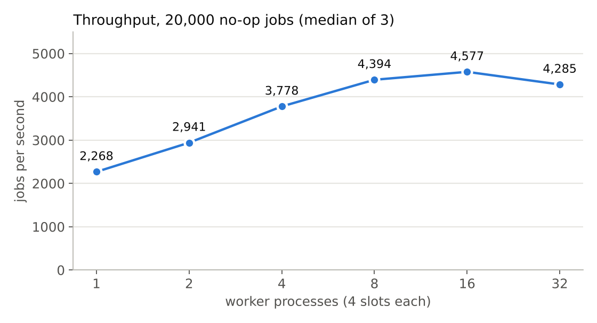
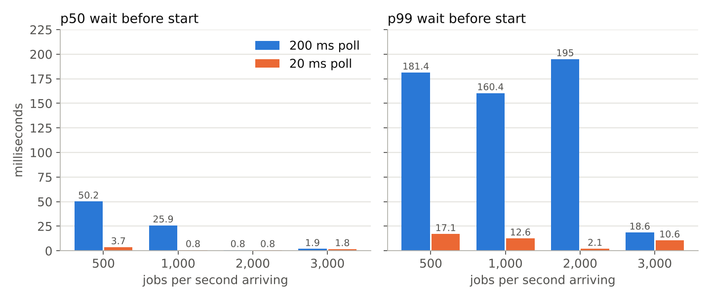
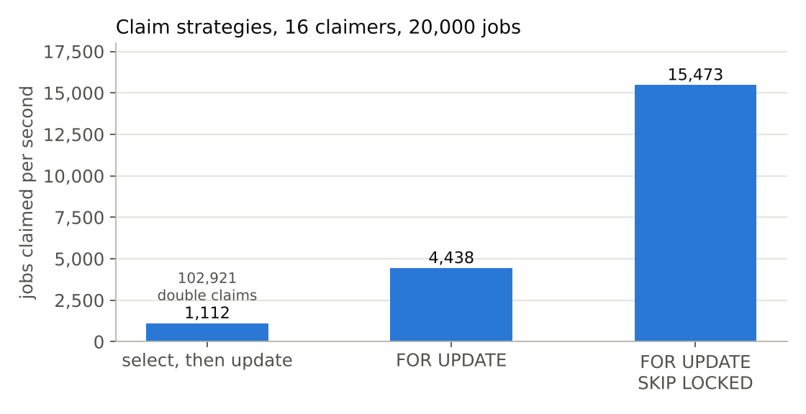
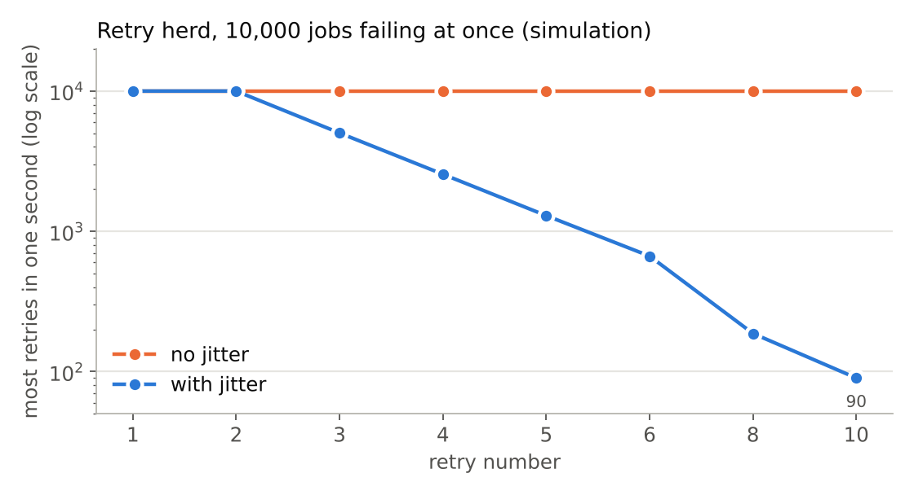

# Results

Every number here comes from a file in [`results/`](results/), which has the machine and git commit at the top. `make bench` and `make chaos` redo them. The charts are drawn by `docs/make_charts.py` from the same numbers.

**Machine:** Apple-silicon MacBook, 8 cores, macOS. PostgreSQL 16.15 in Docker on the same machine (Docker VM: 8 CPUs, 3.8 GB). Go 1.27.3. The database and the workers share the same cores, so read these as laptop numbers, not server numbers. Jobs are no-ops unless it says otherwise.

## Killing workers

4 worker processes, 4 slots each, lease 3 s, reaper every 1 s. During a run a random worker gets `kill -9` and is replaced, 20 times. 2,000 jobs per run, half `side_effect` (idempotent) and half `counter` (not idempotent). Three runs: `results/chaos-1.txt` to `chaos-3.txt`.

| | run 1 | run 2 | run 3 |
|---|---|---|---|
| jobs lost or stuck | 0 | 0 | 0 |
| `side_effect` jobs that ran more than once | 35 | 46 | 36 |
| `side_effect` duplicate effects | 0 | 0 | 0 |
| `counter` jobs that ran more than once | 42 | 33 | 41 |
| `counter` duplicate effects | 44 | 33 | 43 |

- Every kill interrupts exactly 4 jobs (the queue is never empty, so each worker has 4 busy slots). That is why there are 80 crashed attempts per run.
- The jobs keep running for 0.5 to 1.5 s after they write their effect, so a kill nearly always lands after the effect and before "succeeded". The `counter` numbers are close to worst case. Real handlers usually have a smaller window.
- What this shows: nothing accepted was lost, and the idempotent handler never doubled its effect. It does not show exactly-once. That isn't promised.

## Recovery time

Time from `kill -9` until another worker starts the interrupted job again. 20 kills per lease, one number per kill. `results/recovery.txt`.

| lease | median | min to max | range I expected |
|---|---|---|---|
| 1 s | 1.05 s | 0.77 to 1.75 | 0.7 to 2.2 |
| 3 s | 2.87 s | 2.23 to 4.14 | 2.0 to 4.2 |
| 10 s | 9.35 s | 7.03 to 10.41 | 6.7 to 11.2 |

The lower end is about two thirds of the lease (the worker may have heartbeated up to a third of a lease ago). The upper end is the lease plus the reaper interval plus the poll interval. All 60 kills landed inside the expected range.

## Throughput

20,000 no-op jobs inserted before the workers start, so this measures claim + run + record, not submitting. Median of 3. `results/throughput.txt`.

| workers (4 slots each) | jobs/s |
|---|---|
| 1 | 2,268 |
| 2 | 2,941 |
| 4 | 3,778 |
| 8 | 4,394 |
| 16 | 4,577 |
| 32 | 4,285 |

It stops growing around 16 workers. During the run the machine's CPUs were about 98% busy and Postgres used roughly 3.5 of the 8 cores. So this is the limit of this laptop with everything on it. I have not shown it is a limit of the design, and I would not call it "database-bound". Three sessions on different days landed within about 3% of each other.

## Wait time before a job starts

No-op jobs arriving at a steady rate, 4 workers. The time from the job being created until its first attempt starts. `results/latency.txt` (200 ms poll) and `results/latency-poll20-full.txt` (20 ms poll).

| jobs/s arriving | p50 / p95 / p99, 200 ms poll (ms) | p50 / p95 / p99, 20 ms poll (ms) |
|---|---|---|
| 500 | 50.2 / 151.0 / 181.4 | 3.7 / 14.1 / 17.1 |
| 1,000 | 25.9 / 130.9 / 160.4 | 0.8 / 8.3 / 12.6 |
| 2,000 | 0.8 / 52.8 / 195.0 | 0.8 / 1.2 / 2.1 |
| 3,000 | 1.9 / 10.0 / 18.6 | 1.8 / 4.3 / 10.6 |

- When the queue is quiet the wait is mostly the poll interval. A 10x shorter interval gives about 10x lower wait, and idle workers query the database 10x more often. That is the argument for `LISTEN/NOTIFY`, which is not built.
- At higher rates the workers are always busy and finish a job just as another is waiting, so the wait gets short by itself. That is why the 3,000/s row looks better than the 500/s row. It is not a sign that it likes more load.
- **The 3,000 jobs/s row is not stable.** The numbers above are from a good session. In other sessions a backlog built up and waits went to seconds, once up to 55 s. I ruled out checkpoints (Postgres log). The cause is still unknown, see [BUGS.md](BUGS.md). Don't quote the 3,000/s p99 as a promise.

## Claiming

16 claimers going at 20,000 queued jobs, one job per claim, no handlers. `results/claims.txt`.

| | jobs/s | double claims | empty claims |
|---|---|---|---|
| select, then update | 1,112 | 102,921 (83.7%) | 533 |
| `FOR UPDATE` | 4,438 | 0 | 81 |
| `FOR UPDATE SKIP LOCKED` | 15,473 | 0 | 381 |

The first two exist only in `cmd/bench/claims.go`, for this comparison. Don't put these jobs/s next to the throughput table: this one skips everything after the claim.

## Index

1,000,000 rows in `jobs`, 999,000 finished and 1,000 queued. `EXPLAIN ANALYZE` of the claim's SELECT, median of 30. `results/index.txt`.

| | plan | time | size |
|---|---|---|---|
| no index | seq scan | 60.674 ms | |
| index on (status, priority, run_at) | index scan | 0.009 ms | 6.8 MB |
| partial index, queued rows only | index scan | 0.006 ms | 16 KB |

The two indexes are about the same speed. The partial one is much smaller because it only holds the rows that are waiting.

## Retry herd

This is a simulation, not a live run. 10,000 jobs fail at the same moment and I compute when each would retry, using the real backoff function. The peak is the most retries starting inside any one second. Median of 5 trials. `results/herd.txt`.

| retry | wait with jitter | peak/s without jitter | peak/s with jitter |
|---|---|---|---|
| 1 | 0.5 to 1 s | 10,000 | 10,000 |
| 2 | 1 to 2 s | 10,000 | 10,000 |
| 3 | 2 to 4 s | 10,000 | 5,026 |
| 4 | 4 to 8 s | 10,000 | 2,553 |
| 5 | 8 to 16 s | 10,000 | 1,294 |
| 6 | 16 to 32 s | 10,000 | 666 |
| 8 | 64 to 128 s | 10,000 | 187 |
| 10 | 2.5 to 5 min | 10,000 | 90 |

For short waits everything still lands inside one second, so jitter can't help. And all jobs failing at the same instant is the worst case. Real failures are spread out a bit.

## Things these numbers don't cover

- One machine, one Postgres, workers on the same box. No network between them.
- No-op jobs. Real handlers change the picture (they hold slots longer, so waits get longer).
- No long runs. The longest is a few minutes.
- No comparison with other queues. I didn't run River or Sidekiq on this machine, so I make no claim against them.